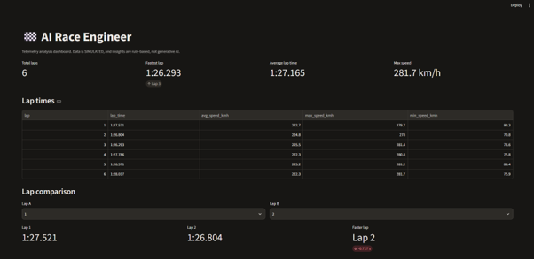
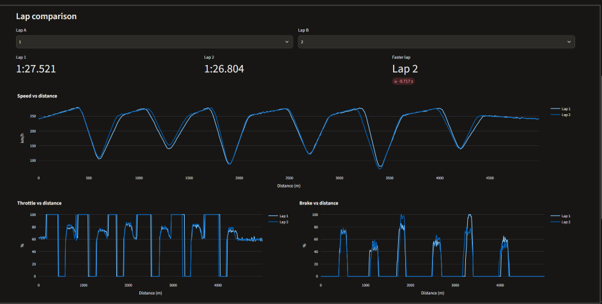
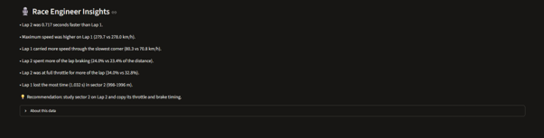

# 🏁 AI Race Engineer

A small Streamlit app that analyzes racing telemetry and gives a "race engineer" style
breakdown of driver performance.

> **Note:** The telemetry is **simulated** (generated by `src/generate_sample_data.py`).
> It is not from a real car or simulator. The insights are **rule-based Python logic**, not generative AI.

## Features
- Generates sample telemetry (6 laps, speed / throttle / brake vs distance) and saves it as CSV
- Loads telemetry from CSV with pandas
- Stats: lap times, fastest / slowest lap, average and max speed
- Interactive Plotly graphs: speed, throttle, brake vs distance
- Compare any two laps and see the lap-time difference
- Automatic insights and recommendations from calculated values (corner speed, braking share, full-throttle share, sector time loss)

## Tech stack
Python, Pandas, NumPy, Plotly, Streamlit, pytest

## Install (Windows, Command Prompt)
```bat
python -m venv .venv
.venv\Scripts\activate
pip install -r requirements.txt
```

## Run
```bat
python src\generate_sample_data.py
streamlit run app.py
```
Run tests: `python -m pytest`

## Project structure
```text
app.py                       Streamlit dashboard
src/generate_sample_data.py  Simulated telemetry generator
src/analysis.py              Stats + rule-based insights
tests/test_analysis.py       Basic tests
data/sample/telemetry.csv    Generated sample data
```

## Screenshot



## Future ideas
Import real telemetry (Assetto Corsa export), more laps/tracks, optional LLM-written summaries.
